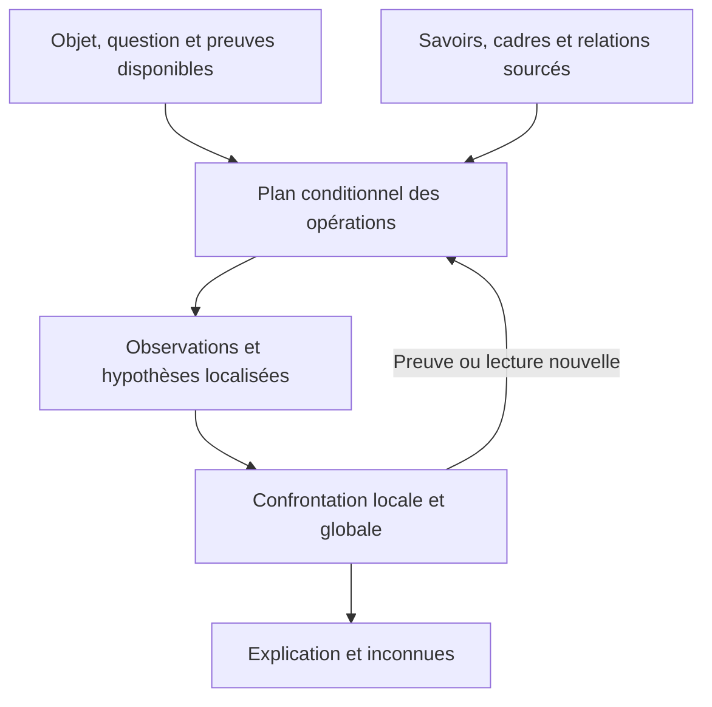

# Plan directeur — tous les savoirs musicaux dans un raisonnement organisé

**22 novembre 2026 · Proposition d'architecture et plan de travail.**

Ce document répond à la précision de Léon : réunir **tous les concepts attestés dans nos cours**, qu'ils concernent les enchaînements, les alternatives, les structures, l'histoire, les cultures, le son ou l'interprétation, et déterminer **où, pourquoi et sous quelles conditions ils interviennent dans l'analyse d'une œuvre**.

Ce plan ne déclare pas cette extraction accomplie. Il remplace, pour la suite du volet, l'idée d'étendre simplement une petite liste de détecteurs. Les mécanismes MIDI existants deviennent des fournisseurs d'observations dans une architecture de connaissance et de raisonnement plus large. Aucun moteur, registre universitaire, corpus, site de cours ou mécanisme de composition n'est modifié par ce document.

## 1. Résultat à construire

Pour une œuvre, un passage et une question donnés, AnaMu doit pouvoir :

1. Identifier les documents, versions, réalisations et médias effectivement disponibles.
2. Mobiliser les savoirs pertinents de l'ensemble de la base, sans dépendre du cours dont ils proviennent.
3. Expliquer les relations locales et globales, les alternatives et les contextes nécessaires.
4. Déterminer quelles opérations peuvent commencer, lesquelles attendent une preuve et lesquelles doivent rester une question documentaire ou humaine.
5. Conserver plusieurs interprétations lorsque les observations ne les départagent pas.
6. Réviser une interprétation locale lorsqu'une phrase, une forme, une réalisation ou un document contextuel apporte une preuve nouvelle.
7. Donner la chaîne qui relie chaque conclusion aux passages de l'œuvre, aux concepts, aux règles et aux sources.
8. Montrer les savoirs écartés, non pertinents dans cette portée, non implémentés ou encore inconnus, avec des motifs distincts.

**« Tous les concepts » définit le périmètre de connaissance ; cela ne signifie pas appliquer toutes les théories à toutes les œuvres.** Un concept peut être enregistré, contextualisé et placé dans le raisonnement tout en restant sans mécanisme automatique. L'histoire et la culture ont un rôle actif dès que les preuves nécessaires sont disponibles.

L'organisation recherchée a deux produits complémentaires : une **cartographie de tous les savoirs documentés** et un **plan d'analyse conditionnel pour chaque œuvre**. Le second est calculé à partir du premier, des entrées et des hypothèses ; ce n'est pas un ordre universel fixé une fois pour toutes.

## 2. Point de départ vérifié et limites de ce travail de planification

Base examinée : commit `0d60d38dd4e2835df1667c719ad6350dcc1ec255`, après la PR #32. L'[inventaire existant](../knowledge/coverage.json) porte l'empreinte `6fcb32c88194f8713d9e8bd8b1401c99d2891ab32c84f2910e9ebbb7eb4b24bf`.

| Élément disponible | Quantité | Interprétation correcte |
|---|---:|---|
| Documents de cours indexés | 424 | 419 identités de cours ; cinq possèdent deux fiches conservées |
| Cours du registre principal | 378 | Huit familles de choix supplémentaires restent non résolues |
| Cours complémentaires représentés | 41 | Ils participent à la connaissance sans gonfler le registre principal |
| Documents transversaux | 76 | Dont 58 lots bruts, deux lots de recherche thématique, références et synthèses |
| Sources structurées JSON | 30 | Matière, provenance, nomenclatures et études ; toutes ne sont pas des règles |
| Fragments documentaires | 4 416 | Une section n'est pas nécessairement un concept, ni un concept unique |
| Concepts rapprochés dans la première version | 25 | Liens partiels vers 21 fiches ; aucun cours entièrement intégré |
| Mécanismes MIDI initiaux | 6 | Observations limitées ; aucune orchestration complète du raisonnement |

Les textes Markdown indexés représentent environ **4,1 Mo**. Le nombre réel de concepts et d'assertions n'est pas connu : il doit résulter de leur extraction et de leur réconciliation, pas d'un objectif chiffré arbitraire.

La préparation de ce plan a examiné l'inventaire global, le schéma courant, le moteur et des fiches contrastées : harmonie, contrepoint, analyse formelle, réduction schenkerienne, percussion, psychoacoustique, électroacoustique, histoire musicale, ethnomusicologie, dramaturgie, tango et musique interactive. **Ce n'est pas une lecture sémantique exhaustive des 424 fiches.** Les exemples ci-dessous servent à concevoir et éprouver le futur modèle ; ils ne constituent pas déjà un catalogue complet.

### Ce que la version actuelle ne représente pas encore

- `prerequisites` est une liste non typée. Le compilateur rejette les cycles, mais le moteur affiche cette liste sans s'en servir pour ordonnancer ni réviser ses conclusions.
- `requires` impose une conjonction de modalités. Il ne représente pas plusieurs voies de preuve équivalentes ou de précision différente.
- L'exécution des six mécanismes est fixée dans le code ; elle n'est pas dérivée des questions et dépendances conceptuelles.
- Une dépendance pédagogique, une condition d'identification, un contexte culturel et une partie de structure ne disposent pas d'arêtes distinctes.
- Le découpage en fragments conserve le texte, mais n'extrait pas les définitions, affirmations, exceptions et opérations contenues dans chaque fragment.
- Les données supplémentaires fournies sont empreintées, sans adaptateurs de partition, d'audio, de paroles ou de contexte qui les interprètent.

Ces limites sont des points de migration. Il faut préserver les sources et les rapports existants sans transformer rétroactivement leur portée.

## 3. Ce qu'on doit inventorier : davantage que des noms de notions

L'unité d'extraction est une **mention sourcée**, rattachée ensuite à un sens de concept et à des assertions. Un paragraphe peut porter plusieurs unités. Le même savoir peut traverser plusieurs paragraphes ou documents.

| Objet à recueillir | Exemple de contenu | Place future |
|---|---|---|
| Concept et définition | Retard, chroma, objet sonore, fonction de chœur | Vocabulaire explicite, sens et distinctions |
| Relation musicale | Préparation–dissonance–résolution ; rappel–transformation | Structure et trajectoire à reconnaître |
| Catégorie et alternatives | Types de cadence, variantes de texture, transformations motiviques | Comparaison et discrimination |
| Principe conditionnel | Interprétation valable sous certaines conventions | Règle avec portée et exceptions |
| Méthode d'analyse | Réduction, comparaison de versions, observation de terrain | Procédure, opérations et besoins de preuve |
| Convention | Graphie, transposition instrumentale, nomenclature GM | Interprétation des représentations |
| Connaissance historique ou culturelle | Pratique documentée, institution, circulation, réception | Contexte et explication justifiés |
| Fait sur une œuvre ou une réalisation | Version, instrumentation attestée, scène, reprise | Contexte spécifique, jamais règle générale implicite |
| Question interprétative | Rapport thème–personnage, importance structurelle | Hypothèses argumentées, éventuellement humaines |
| Exemple et contre-exemple | Même verticale, autre conduite ; thème sans personnage | Appui et discrimination avec localisation |
| Prescription compositionnelle | Manière de préparer une arrivée ou répartir un effectif | Savoir conservé ; l'intention de l'auteur n'en découle pas |
| Lacune ou terme seulement nommé | Domaine au catalogue sans définition disponible | Mention à préciser, pas définition inventée |

Les crédits, dates de collecte, consignes administratives et anciennes instructions opérationnelles reçoivent une qualification propre. Ils restent traçables, mais ne deviennent pas des concepts musicaux. Les métiers de la musique restent dans le périmètre existant ; leur rôle peut être documentaire, lié à la production ou à la faisabilité, sans prétention de détection sonore.

Une consigne « composer une phrase avec un retard » permet de repérer un savoir et une tâche. Elle ne prouve ni que le retard est complètement défini dans cette source, ni que tout retard exprime une intention particulière.

## 4. Organisation à plusieurs dimensions

Il ne faut pas placer chaque concept dans un unique dossier exclusif. Les dimensions suivantes se croisent ; leurs valeurs restent extensibles et peuvent être inconnues. Elles sont une **proposition d'organisation AnaMu**, pas une taxonomie déjà enseignée à l'identique dans tous les cours.

| Dimension | Question posée | Valeurs ou cas à représenter |
|---|---|---|
| Domaine musical | Sur quoi porte le savoir ? | Hauteur, rythme, voix, harmonie, forme, timbre, espace, geste, texte, contexte… |
| Axe syntagmatique | Quelles relations dans une réalisation ? | Succession, simultanéité, préparation, dépendance, transition, continuité ; pas seulement « avant/après » |
| Axe paradigmatique | Quelles alternatives ou parentés ? | Famille, variante, substitution conditionnelle, contraste, transformation, équivalence sous un invariant déclaré |
| Échelle et portée | Quel ensemble est concerné ? | Événement, relation, cellule, ligne, texture, phrase, section, œuvre, ensemble d'œuvres, pratique |
| Organisation hiérarchique | Quel lien de structure ? | Inclusion, élaboration, dépendance structurelle, niveau de réduction ; plusieurs hiérarchies possibles |
| Contexte | Sous quelles conventions ? | Tradition, pratique située, époque, formation, fonction sociale, production, cadre théorique |
| Statut épistémique | Quelle sorte de proposition ? | Donnée, observation dérivée, convention, hypothèse, fait documentaire, jugement perceptif, interprétation |
| Accès à la preuve | De quoi dispose-t-on ? | MIDI vérifié, partition, audio, texte, vidéo, métadonnées, archive, témoignage, annotation |
| Rôle analytique | Que fait ce savoir ? | Observer, regrouper, comparer, contraindre, contextualiser, proposer, départager, expliquer, questionner |
| État d'avancement | Jusqu'où est-il traité ? | Mention repérée, définition étayée, rapprochement revu, placement proposé, mécanisme disponible, expertise indépendante |

**Exemple : le retard.** Il peut être syntagmatique par son histoire temporelle, paradigmatique par sa distinction avec l'appoggiature, local dans ses événements et lié à une cadence à plus grande échelle. Sa définition et ses critères changent avec le cadre stylistique. Ces placements se cumulent.

**Exemple : le tango.** Un savoir sur l'articulation et le phrasé peut relier gestes, interprétations comparées, accompagnement et contexte culturel. La fiche ne permet pas de déduire une provenance géographique depuis une cellule rythmique. Un genre, une institution et une œuvre sont des entités contextualisées ; ils ne sont pas tous des sous-types de « motif ».

Les états d'avancement sont eux aussi **indépendants** : qualité de la source, revue de la définition, rapprochement, placement, disponibilité d'une opération et évaluation musicale. Une unité peut être bien documentée, correctement placée, utilisable par annotation humaine et sans détecteur logiciel. Elle n'est pas pour autant une connaissance de moindre rang. Une seule chaîne de statuts croissants ne doit pas écraser ces dimensions.

### Des hiérarchies différentes doivent rester différentes

1. **Taxonomie** : un type particulier appartient à une famille de concepts.
2. **Parties de l'œuvre** : une réalisation de motif peut participer à une phrase ; les segments peuvent aussi se chevaucher.
3. **Structure interprétée** : une note de surface peut élaborer un événement structurel selon une réduction donnée.
4. **Progression d'apprentissage** : un cours suppose une compétence antérieure.
5. **Dépendance de preuve** : une conclusion exige des observations ou hypothèses d'un niveau suffisant.
6. **Chronologie historique** : un document date une pratique ou une institution ; cela ne fixe pas l'ordre d'exécution des règles.

Aucune de ces relations ne doit être automatiquement convertie en une autre. Une note longue n'est pas nécessairement structurelle ; un cours avancé n'apporte pas toujours un concept qui doit être appliqué tard dans l'analyse.

## 5. Modèle proposé : sources, concepts, assertions, opérations et conclusions

On peut commencer par des fichiers JSON versionnés et des vues Markdown/CSV. Le besoin de relations ne justifie pas à lui seul un serveur de base de graphes. Le stockage doit rester remplaçable.

| Objet | Responsabilité | Champs essentiels proposés |
|---|---|---|
| `SourceDocument` | Identifier un document et sa version | Chemin, empreinte, auteur/attribution, nature, édition, cours ou support parallèle, accès |
| `SourceSpan` | Localiser un contenu revérifiable | Document, lignes/section ou pointeur JSON, extrait de travail licite, empreinte |
| `Mention` | Relever ce qui apparaît réellement | Formulation, langue, source, sens candidat, état et commentaire de lecture |
| `ConceptSense` | Définir un sens musical stable | ID, définition, noms, dimensions, distinctions, limites, statut de réconciliation |
| `KnowledgeAssertion` | Porter une proposition délimitée | Sujet, relation/propriété, objet, conditions, portée, sources, exceptions, état de revue |
| `Relation` | Relier des objets avec un type | Extrémités typées, direction, portée, justification, version et statut |
| `AnalysisOperation` | Décrire un travail à effectuer | Question, entrées qualifiées, alternatives de preuve, sorties, préconditions, déclencheurs, limites |
| `EvidenceItem` | Identifier une preuve d'œuvre | Œuvre/version/prise, média, emplacement, transformation de données, précision et incertitude |
| `AnalysisClaim` | Conserver une conclusion contextualisée | Proposition, passage, cadre, appuis, objections, hypothèses concurrentes, statut, dépendances de versions |
| `AnalysisTask` | Placer une opération dans un parcours | Portée, conditions satisfaites/manquantes, priorité, état d'exécution, résultat et reprises nécessaires |

Le **concept** décrit une connaissance. L'**opération** décrit un moyen de la mobiliser. La **conclusion** porte sur une occurrence dans une œuvre. Une même opération peut servir plusieurs concepts ; un concept peut nécessiter plusieurs opérations ou seulement une enquête documentaire.

### Identité et sens

- Garder des identifiants stables, sans placer époque, cours et rang d'exécution dans l'ID.
- Une traduction ou un synonyme proposé est une correspondance à examiner, pas une fusion automatique.
- Distinguer plusieurs sens d'un terme lorsqu'ils ne partagent pas leurs critères ; relier ensuite leur parenté éventuelle.
- Une fusion conserve les mentions, variantes, divergences et anciens identifiants. Une scission conserve ses motifs et redirections.
- Ne pas compter deux copies d'une même source comme deux confirmations indépendantes.
- Le concept demeure séparé des assertions : deux sources peuvent s'accorder sur son existence et diverger sur une règle ou une limite.

### Qualité des données et voies de preuve

Remplacer progressivement la liste plate `requires` par des contrats d'entrée et de sortie. Une analyse peut recevoir une partition avec voix annotées, ou un MIDI dont l'affectation de voix a été vérifiée. Cela ne rend pas ces deux supports équivalents pour la graphie, les gestes ou le son.

Exemple de contrat conceptuel, **non implémenté** :

```yaml
operation: examiner_un_retard_dans_un_cadre_declare
scope: passage_et_voix_candidates
proof_routes:
  any_of:
    - all_of: [partition_avec_liaisons, voix_identifiees, cadre_stylistique]
    - all_of: [evenements_verifies, continuite_de_voix_annotee, cadre_stylistique]
produces:
  - histoire_preparation_dissonance_resolution_candidate
cannot_establish:
  - continuite_percue_sans_preuve_auditive
  - perfection_cadentielle_sans_examen_de_la_suite
revisit_when:
  - revision_des_voix
  - nouvelle_lecture_de_phrase
  - changement_du_cadre_interpretatif
```

Chaque voie doit préciser la force de sa conclusion. Une seconde voie plus pauvre ne doit pas produire silencieusement la même assertion qu'une partition complète. On peut observer un candidat sans disposer encore de la preuve nécessaire pour le retenir.

## 6. Vocabulaire des relations et conséquences pour l'ordre d'analyse

| Relation proposée | Sens | Effet sur l'exécution |
|---|---|---|
| `is_a` | Spécialisation d'un sens | Navigation ; pas de prérequis d'exécution implicite |
| `part_of` | Participation d'une occurrence à un ensemble | Structure de l'œuvre, éventuellement partielle ou concurrente |
| `elaborates` | Élaboration à un niveau d'analyse | Hiérarchie justifiée dans un cadre donné |
| `contrasts_with` | Distinction à vérifier | Invite une comparaison, sans exclusivité automatique |
| `alternative_to` | Hypothèses concurrentes dans une portée | Maintient plusieurs lectures jusqu'à discrimination |
| `transforms_into` | Relation sous une transformation explicitée | Comparaison avec invariants, paramètres et pertes déclarés |
| `precedes` / `overlaps` | Relation temporelle entre occurrences | Contraint la chronologie musicale, pas celle du logiciel |
| `requires_evidence` | Preuve indispensable à une conclusion définie | Bloque cette conclusion si elle manque |
| `benefits_from` | Indice utile, non indispensable | Priorise ou renforce l'examen, sans bloquer toutes les autres voies |
| `pedagogically_requires` | Compétence préalable dans un apprentissage | Sert aux parcours d'étude, pas directement à l'analyse d'œuvre |
| `applies_under` | Conditions d'emploi d'une assertion | Active une branche contextualisée ou conserve une lecture conditionnelle |
| `supports` / `challenges` | Appui ou objection à une assertion | Met à jour son dossier de preuve, pas une vérité globale |
| `historically_attested_in` | Association documentaire située | Contextualise ; aucune inférence d'identité culturelle par simple ressemblance |
| `revisits_on` | Résultat à réexaminer sur changement pertinent | Invalide ou réouvre les dépendants concernés |

Une relation ajoutée par AnaMu conserve sa justification et son statut de proposition, même lorsque ses extrémités sont bien sourcées. Une citation qui définit deux concepts ne prouve pas automatiquement le lien que nous proposons entre eux. La provenance distingue toujours texte de source, résumé, interprétation de l'analyste et décision d'architecture.

Les contraintes combinées doivent pouvoir s'exprimer en **ET/OU**, avec plusieurs entrées et sorties. Une simple arête A→B ne suffit pas à représenter « A et B, ou bien C annoté ».

Toutes les relations n'ont pas les mêmes propriétés. Une spécialisation doit éviter les cycles incohérents. Une similarité n'est pas nécessairement transitive. Une substitution n'est valable que pour une fonction, un contexte et des invariants annoncés. Une contradiction concerne deux propositions de même portée, pas simplement deux phrases contenant des mots opposés.

Les variantes théoriques ne doivent pas hériter de règles incompatibles par une taxonomie trop large. Le moteur doit pouvoir comparer deux cadres sans construire une théorie hybride dont aucune source ne répond.

## 7. « Dans quel ordre ? » : quatre ordres et un parcours adaptable

### Quatre questions à séparer

| Ordre | Exemple | Représentation |
|---|---|---|
| Ordre musical | Une préparation précède une résolution | Relations entre occurrences, horloges et intervalles |
| Ordre de structure | Surface et prolongation à plusieurs niveaux | Graphes d'analyse rattachés à des hypothèses |
| Ordre d'apprentissage | Un syllabus suppose l'harmonie de premier niveau | Relations pédagogiques sourcées |
| Ordre du raisonnement | Il manque l'histoire des attaques pour départager deux lectures | Préconditions et tâches sur des états de preuve |

Le dernier doit utiliser les autres sans les confondre. Une connaissance historique fournie au départ peut orienter immédiatement le choix des cadres. Une information de réception ajoutée tard doit pouvoir rouvrir une interprétation ; elle n'est donc pas condamnée à une « étape finale de contexte ».

### Parcours proposé

| Moment de travail | Travail possible | Point de révision |
|---|---|---|
| A. Identifier l'objet et la question | Œuvre, édition, arrangement, réalisation, passage, objectif de l'analyse et contexte déjà attesté | Nouvelle version ou erreur d'identification |
| B. Qualifier les entrées | Contrats MIDI, notation, audio, texte, vidéo, archives ; alignements et incertitudes | Nouveau média ou alignement corrigé |
| C. Proposer des observations et groupements | Événements, objets sonores, voix candidates, repères temporels, textures | Détection ou segmentation corrigée |
| D. Construire des lectures locales | Relations de voix, sonorités, transformations, gestes, interactions | Autre affectation de voix ou autre cadre |
| E. Examiner les structures plus étendues | Phrase, processus, retours, prolongations, forme, dramaturgie | Contexte avant/après et autres occurrences |
| F. Confronter les interprétations | Cohérence locale/globale, alternatives, preuves historiques, perceptives et culturelles | Objection, contre-exemple ou nouvelle preuve |
| G. Produire une explication | Conclusions bornées, candidats restants, inconnues, connaissances mobilisées | Demande complémentaire ou source nouvelle |

Ces moments sont des repères lisibles, **pas sept barrières qui imposent d'achever toutes les tâches d'une ligne avant la suivante**. Les branches peuvent avancer en parallèle logique et revenir sur des résultats antérieurs. Une œuvre électroacoustique ne doit pas attendre qu'une analyse d'accords inexistante soit terminée.



### Règles pour l'ordonnanceur futur

1. Créer des tâches pour les opérations pertinentes, avec une portée et des entrées versionnées ; ne pas « exécuter un concept » abstrait.
2. Distinguer préconditions strictes de conclusion, indices souhaitables et hypothèses provisoires. Donner à une hypothèse une portée conditionnelle explicite permet d'avancer sans la présenter comme acquise.
3. Exécuter les tâches dont une voie de preuve suffisante est disponible. Expliquer les blocages, au lieu de leur donner arbitrairement un rang très tardif.
4. Préférer ce qui est nécessaire à la question, départage réellement les lectures, réduit un blocage ou traite une dépendance commune. Documenter les choix de coût et de priorité ; ne pas inventer un score universel de pertinence.
5. Enregistrer les propositions **et leurs justifications**. Deux chemins dérivés d'une même preuve ne sont pas deux preuves indépendantes.
6. Lorsqu'une entrée change, marquer les conclusions dépendantes comme à revoir et recalculer seulement la partie concernée. Garder la trace de l'ancienne lecture et de la raison de sa révision.
7. Limiter explicitement les fenêtres, le nombre de branches et les reprises. Une branche interrompue reste inachevée, jamais « fausse » par dépassement de budget.
8. Terminer lorsqu'aucune opération justifiée n'apporte de changement pertinent, ou lorsque le budget est atteint. Signaler les divergences non résolues et la raison de l'arrêt.

### Cycles sans preuve circulaire

Le graphe de connaissances peut contenir des relations réciproques : phrase et cadence s'éclairent mutuellement. Il faut donc cesser de lui imposer globalement un unique graphe acyclique.

En revanche, une justification ne peut pas conclure « cadence parce que fin de phrase » et « fin de phrase parce que cadence » sans autre appui. Chaque proposition retenue doit disposer d'un chemin vers des preuves extérieures au cycle. Dans le plan d'exécution, les composantes interdépendantes deviennent des groupes de tâches avec hypothèses initiales, révisions et critère d'arrêt. Les dépendances de justification restent vérifiables et versionnées ; un cycle sans ancrage demeure une question ouverte.

## 8. Histoire, culture, perception et jugement : une place de plein droit

Ces savoirs doivent pouvoir **sélectionner des questions, délimiter des catégories, modifier des attentes et expliquer des choix documentés**. Les coder tous comme « non automatisables » puis les ignorer perdrait une partie essentielle du projet.

Trois situations doivent être distinguées :

- **Fait documentaire disponible** : date d'une édition, dispositif scénique, crédit, pratique décrite, témoignage attribué. Il peut entrer dans le raisonnement avec sa source et sa portée.
- **Hypothèse contextuelle** : rapprochement stylistique ou fonction possible. Elle reste candidate ; la ressemblance musicale ne lui confère pas une provenance certaine.
- **Question ouverte ou jugement situé** : réception, expérience d'écoute, enquête culturelle, sens dramaturgique. Le système organise les arguments et les éléments manquants, et peut demander une annotation humaine sans prétendre produire une mesure équivalente.

Pour les comparaisons paradigmatiques, préciser **l'ensemble de référence** : variantes dans cette œuvre, autres interprétations, famille théorique ou corpus historiquement documenté. Une alternative n'est équivalente que sous les dimensions et invariants annoncés ; elle peut modifier d'autres propriétés. Préserver aussi le vocabulaire des praticiens et celui du cadre d'analyse lorsqu'ils diffèrent, au lieu de forcer toute pratique dans nos catégories initiales.

Le contexte doit pouvoir s'attacher à une œuvre, une section, une version, une interprétation ou une pratique ; pas seulement à un champ global `style`. Une pièce peut mêler citations, techniques et conventions. Les frontières de contexte peuvent être incertaines et concurrentes.

Le concept peut porter un domaine de validité sans être réservé à des dates rigides : une convention historique peut être citée, réemployée ou transformée ultérieurement. Il faut séparer **date d'attestation**, **période d'une pratique**, **date de l'œuvre**, **date de l'arrangement**, **date de l'enregistrement** et **date de collecte**.

Une antériorité ou une ressemblance ne démontre pas à elle seule une influence, une filiation ou une cause sociale. Ces assertions demandent leur propre dossier de sources, et une explication analytique doit pouvoir rester comparative sans devenir causale.

La fiche [MUL-3314](../../docs/courses/udem/MUL-3314.md) demande précisément de ne pas assigner gamme ou instrumentation à une population par généralisation. [MHIS-341](../../docs/courses/berklee/MHIS-341.md) lie la compréhension à des archives et enregistrements identifiés. Les deux ont donc une place conceptuelle et des besoins de preuve ; ils ne sont pas des décorations d'un résultat MIDI.

La perception réclame la même précision : séparation de voix notées et ségrégation auditive, consonance contrapuntique et rugosité, commande de vélocité et sonie. [MUS-3321](../../docs/courses/udem/MUS-3321.md) justifie de maintenir ces objets séparés.

## 9. Temps, échelles et supports

L'analyse doit disposer d'emplacements qui ne forcent pas toutes les observations dans une mesure MIDI unique.

- Garder ticks et ordre des événements, mesures/temps notés, secondes de la prise, positions de texte et timecodes vidéo comme systèmes distincts.
- Un alignement est une relation versionnée avec incertitude ; une conversion ne doit pas masquer reprises, coupes ou variantes.
- Autoriser des segments emboîtés, disjoints ou chevauchants. Un motif peut réapparaître dans plusieurs sections ; deux couches peuvent avoir des horloges différentes.
- Séparer œuvre, partition/édition, arrangement, exécution, enregistrement, export et transcription. Deux fichiers d'empreintes distinctes ne sont pas nécessairement deux œuvres ou deux preuves indépendantes.
- Distinguer identité d'un événement, continuité d'une voix, geste, durée sonore et rôle structurel.

La [synthèse transversale existante](../../docs/knowledge-base.md) a déjà de nombreux contre-cas : retards, ambiguïtés enharmoniques, percussion, horloges, résonance, partitions transposées. Il faut extraire leurs relations, pas seulement importer leurs titres.

Pour les corpus, les paroles disponibles et les horodatages ne certifient pas l'appariement voix–syllabe. Les réalisations pop et les éditions d'opéra doivent conserver leur provenance et leur statut d'alignement. Le raisonnement devra dire quelle version et quel texte sont concernés.

## 10. Parcours exemplaires pour concevoir le système

Ces parcours sont des **cas de conception** fondés sur des fiches existantes. Ils ne décrivent pas des capacités déjà implémentées.

### 10.1 Même verticale, plusieurs fonctions : observation puis départage

**Sources :** [MTE-1221](../../docs/courses/udem/MTE-1221.md), [MUTH-251](../../docs/courses/mcgill/MUTH-251.md), [CM-211](../../docs/courses/berklee/CM-211.md) et synthèse harmonique commune.

1. Observer les événements et construire la sonorité sous contrat connu.
2. Proposer les familles de lectures compatibles ; garder distinctes graphie, basse et fonction.
3. Examiner la continuité des voix, les mouvements suivants, la phrase et les centres candidats.
4. Confronter les lectures dans leurs cadres : la ressemblance de classes de hauteurs ne fusionne pas sixte allemande et septième de dominante.
5. Conserver plusieurs lectures si la graphie ou le contexte manque ; indiquer précisément ce qui les départagerait.

**Axes :** paradigmatique pour les alternatives ; syntagmatique pour leurs préparations et destinations ; hiérarchique pour fonction locale et contexte étendu.

### 10.2 Retard : une histoire locale dépend d'une pratique

**Sources :** [MUTH-202](../../docs/courses/mcgill/MUTH-202.md), [MUTH-204](../../docs/courses/mcgill/MUTH-204.md), [OCOMP-250](../../docs/courses/berklee-online/OCOMP-250.md).

1. Identifier des voix candidates et suivre le même événement tenu, ou constater sa réattaque.
2. Relever préparation, changement créant la dissonance et résolution candidate.
3. Comparer retard, appoggiature et autres lectures dans le cadre annoncé.
4. Examiner, lorsque le cadre le demande, l'arrivée plus conclusive après la première résolution ; ne pas généraliser une définition à trois phases à toutes les traditions.
5. Réviser la lecture si l'affectation de voix, l'articulation ou la frontière de phrase change.

**Ordre :** on peut repérer une tenue avant de connaître le style ; son nom fonctionnel et sa portée cadentielle requièrent des preuves supplémentaires.

### 10.3 Retour de matériau, leitmotiv et dramaturgie

**Sources :** [OCOMP-491](../../docs/courses/berklee-online/OCOMP-491.md), [MUL-6257](../../docs/courses/udem-supplementary/MUL-6257-H27.md).

1. Relever des parentés de matériau et préciser les transformations conservées ou perdues.
2. Vérifier leur répartition dans des phrases, sections et scènes identifiées.
3. Comparer leurs associations au texte, aux personnages et à l'action, y compris les contre-exemples.
4. Distinguer identité musicale candidate, fonction dramatique proposée et intention documentée.
5. Utiliser une révision dramaturgique pour reconsidérer la fonction d'une occurrence, sans modifier les événements observés.

**Manques visibles :** le MIDI seul peut soutenir certaines parentés ; il ne contient ni personnage ni genèse de livret. Le séminaire sur *Lulu* n'autorise pas à inventer un catalogue universel de leitmotive pour tous les opéras.

### 10.4 Timbre et organisation électroacoustique

**Sources :** [MTE-3300](../../docs/courses/udem/MTE-3300.md), [MUS-3321](../../docs/courses/udem/MUS-3321.md), [MUL-3208X/6208X](../../docs/courses/udem-supplementary/MUL-3208X-6208X.md).

1. Identifier la réalisation audio et les cadres d'écoute pertinents.
2. Proposer objets, évolutions et frontières à partir de preuves sonores et d'annotations.
3. Comparer trajectoires, contrastes et parentés sans imposer note–accord–cadence.
4. Mettre en relation le parcours sonore et les pratiques de production historiquement documentées.
5. Garder distincts mesure spectrale, jugement d'écoute et interprétation esthétique.

**Enjeu :** cette branche doit pouvoir fonctionner sans MIDI. L'absence d'accord n'est pas une insuffisance de l'œuvre.

### 10.5 Hiérarchies concurrentes et réduction

**Source :** [MUTH-528](../../docs/courses/mcgill/MUTH-528.md).

Construire, dans un cadre tonal explicitement retenu, plusieurs niveaux d'élaboration et comparer les justifications de notes structurelles. Ne pas transformer la durée ou le registre en critère automatique de prééminence. Conserver des réductions concurrentes ; l'ordre pédagogique du syllabus parallèle ne devient pas l'ordre d'analyse obligatoire. Les graphes de réduction sont des objets d'interprétation, distincts de la taxonomie des concepts.

### 10.6 Articulation d'une pratique et comparaison d'interprétations

**Sources :** [MUL-6262](../../docs/courses/udem-supplementary/MUL-6262-H27.md), [MUL-3314](../../docs/courses/udem/MUL-3314.md), [MHIS-341](../../docs/courses/berklee/MHIS-341.md).

Identifier les interprétations et documents ; comparer phrasé, accompagnement, gestes et conventions décrites ; contextualiser les différences ; conserver les points qui demandent expertise ou enquête. Une similarité rythmique devient un objet de comparaison, pas un certificat d'appartenance culturelle. Une information historique peut être acquise avant toute lecture de notes et guider la question analytique.

### 10.7 Percussion : les états indépendants ne se remplacent pas

**Source :** [CM-343](../../docs/courses/berklee/CM-343.md).

Les attaques, durées de touches, commandes de pédale, gestes d'amortissement, effectif physique, résonance et fonction de transition ont des preuves et temporalités distinctes. L'ordre d'examen dépend de la question : audit d'export, jouabilité ou frontière sonore. Ce cas oblige à vérifier que le modèle ne prend pas un événement technique pour une fonction musicale.

### 10.8 Retour thématique, boucle et déclenchement de jeu

**Sources :** [MUS-2327](../../docs/courses/udem/MUS-2327.md), [MUS-2328](../../docs/courses/udem/MUS-2328.md).

Comparer la réapparition locale, le cycle complet et les chronologies d'états de jeu. Une parenté de deux mesures ne prouve pas un retour de boucle ; une boucle audio ne prouve pas les conditions de déclenchement. Le système doit pouvoir relier ces trois niveaux et conserver leur indépendance lorsqu'il manque la captation de jeu ou la trace d'événements.

## 11. Extraction exhaustive : procédure et fermeture du périmètre

### 11.1 Figer une édition des entrées

Créer un manifeste des documents et objets structurés de l'édition à traiter : chemins, empreintes, types, liens de provenance et exclusions motivées. Conserver les cinq paires de fiches. Les familles de choix restent des questions de périmètre ; elles ne deviennent pas des cours fictifs. L'exclusion de documents de pilotage reste explicite.

### 11.2 Lire tout le contenu, puis qualifier chaque portion

Parcourir tous les textes et les sous-objets pertinents des JSON, pas seulement les titres « apprentissage ». Associer chaque portion à au moins une disposition :

- mention ou assertion musicale extraite ;
- exemple ou contre-exemple relié à un savoir ;
- preuve documentaire ou convention conservée ;
- élément pédagogique ou de production qualifié ;
- métadonnée ou texte opérationnel sans nouvel apport musical ;
- terme nommé mais matière insuffisante ;
- passage ambigu restant à examiner.

Une section avec plusieurs objets peut recevoir plusieurs dispositions. Les sources externes seulement citées sont enregistrées comme telles ; elles ne sont pas considérées lues dans leur intégralité. Les lacunes de syllabus restent ouvertes et la collecte publique arrêtée n'est pas relancée mécaniquement.

### 11.3 Extraire les mentions avant les regroupements

Conserver intitulé original, formulation, contexte, preuve de définition, exemples, limites et statut d'attribution. Récolter les propositions positives et négatives : « le Note Off ne démontre pas le choke » est une connaissance de distinction, pas une simple réserve à jeter.

Un outil linguistique ou un modèle peut proposer des candidats lors d'une future implémentation, mais chaque proposition doit rester liée à un passage et revue. Aucun modèle ou coût externe n'est engagé par ce plan. La fréquence d'un mot, son absence dans les titres ou la facilité de programmation ne décide pas de sa valeur.

### 11.4 Réconcilier sans aplatir

Comparer définitions, conditions, supports, exemples et critères de distinction. Décider entre : sens équivalent, traduction probable à vérifier, spécialisation, variante contextualisée, contraste, homonymie ou relation encore indéterminée. Conserver la justification de chaque décision.

Ne pas fabriquer une règle « moyenne » de deux traditions contradictoires. Une source parallèle éclaire un concept sans devenir le syllabus du cours qui la cite.

### 11.5 Donner une place à chaque sens et assertion

Pour chaque unité retenue, renseigner dimensions, relations, rôle analytique, préconditions et moyens de preuve. Lorsque l'information manque, donner **le placement proposé et la question ouverte**, sans rendre ce placement définitif. Un placement autonome est légitime si aucune dépendance n'est attestée ; une arête inventée pour raccorder le graphe ne l'est pas.

### 11.6 Revoir les omissions

Faire une seconde lecture orientée vers ce qui disparaît facilement : histoire, culture, texte, perception, gestes, temporalités longues, méthodes d'enquête, réception, pratiques professionnelles, contre-exemples et divergences théoriques. Revoir aussi les documents déclarés « sans nouvel apport » et les termes nommés sans définition.

La fermeture d'une édition signifie que **tout le contenu disponible a reçu une disposition revue et que toutes les unités identifiées ont une place ou un blocage explicite**. Elle ne signifie pas posséder les syllabus manquants, avoir extrait tout savoir humain possible, ni savoir automatiquement appliquer chaque concept.

## 12. Livrables et séquencement du chantier

Les chemins de cette section sont **proposés pour les travaux suivants**. Ils ne désignent pas des fichiers déjà créés. Ce plan contient le séquencement propre au volet ; il ne duplique pas les tâches universitaires de collecte.

| Lot | Travail et livrables proposés | Dépendances | Condition de sortie |
|---|---|---|---|
| P0 — Contrat | Vocabulaire d'objets, relations, états, portée et preuves ; décisions dans `analysis/architecture/` | Présent plan | Les huit parcours de conception peuvent être décrits sans confusion d'objet ni règle universelle imposée |
| P1 — Édition de sources | `analysis/knowledge/source-manifest.json` et registre de disposition | P0 ; inventaire existant | Tous les fichiers de l'édition ont un statut ; alias, copies et sources parallèles restent visibles |
| P2 — Extraction de toute la matière | Mentions et assertions par provenance dans `analysis/knowledge/mentions/` | P1 | Tous les passages et JSON pertinents ont été lus et qualifiés ; ambiguïtés non effacées |
| P3 — Réconciliation et placement | Sens, assertions, relations et décisions dans `analysis/knowledge/` ; vues par cours et domaine | P2, par lots revus | Chaque unité extraite est rapprochée, contextualisée ou explicitement en attente ; aucune branche historique/culturelle n'est omise |
| P4 — Planificateur de preuve | Contrats d'opérations et plans conditionnels, sans multiplication immédiate de détecteurs | P0 et une tranche cohérente de P3 | Les tâches prêtes, conditionnelles, bloquées et reprises nécessaires sont expliquées ; les cycles ne servent pas de preuve |
| P5 — Parcours verticaux contrastés | Dossiers de raisonnement manuel puis instrumentation limitée des huit familles de cas | P3/P4 ; preuves adaptées | La provenance, les alternatives et les révisions sont lisibles dans chaque cas ; les branches sans MIDI ont une place effective |
| P6 — Extension des capacités | Opérations génériques par ensembles de connaissances, adaptateurs nécessaires | P3–P5 pour la capacité concernée | Chaque capacité annonce exactement quelles conclusions et limites elle prend en charge |
| P7 — Revue musicale et usages | Dossiers de cas annotés, désaccords, comparaisons et expertise indépendante | Capacités de P6 | Les affirmations de qualité reposent sur des preuves adaptées ; les limites non évaluées restent nommées |
| P8 — Consultation et entretien | Vue du graphe, parcours « pourquoi maintenant ? », suivi des versions et changements | P3/P4 ; enrichi ensuite | Navigation source→savoir→opération→conclusion et chemin inverse ; mise à jour sans perte d'historique |

**Priorité immédiate : P0, P1 et P2 sur tout le périmètre.** P3 peut commencer au fil des lots, mais la lecture de l'ensemble ne doit pas être abandonnée dès qu'une poignée de concepts faciles fournit un prototype satisfaisant. P4 peut être conçu sur des dossiers manuels pendant cette lecture. P6 ne remplace pas le travail d'inventaire sémantique.

### Ordre de passage pour l'extraction

Commencer par une calibration courte et contrastée, tirée des huit parcours de la section 10. Elle sert à stabiliser la granularité et la distinction mention–concept–assertion. Puis parcourir tous les cours par établissement/code et tous les documents transversaux, avec un suivi unique de disposition. Les documents sources d'un même concept peuvent être relus ensemble pour sa réconciliation, sans faire disparaître le suivi document par document.

Ne pas produire une suite de lots exclusivement « harmonie, puis harmonie plus avancée ». La calibration couvre les différentes natures de savoir ; le passage exhaustif couvre les sources restantes. Les compléments, séminaires, pratiques d'ensemble et domaines sans MIDI doivent figurer explicitement au bilan de chaque édition.

### Taille des lots et estimation d'effort

Le nombre de concepts n'étant pas connu, un délai global précis serait prématuré. Après calibration, relever temps de lecture/revue, mentions par document, désaccords et besoin de scission. Estimer ensuite séparément extraction, réconciliation et implantation. Les estimations se révisent sur des lots hétérogènes ; une fiche de catalogue et une longue synthèse de percussion n'ont pas la même charge.

Les lots doivent être assez petits pour relire leurs décisions et reprendre en cas de changement du schéma. Leur unité est un ensemble de sources et de dispositions terminé, pas « ajouter cent concepts ». Chaque livraison indique ce qui est effectivement lu, ce qui reste et les décisions modifiées.

## 13. Critères de revue et mesures de couverture

Ne pas fabriquer un pourcentage unique qui mélangerait indexation, connaissance et implémentation.

| Mesure | Dénominateur ou périmètre | Ce qu'elle permet de conclure |
|---|---|---|
| Lecture documentaire | Documents de l'édition, distincts des cours | Tous les documents sont examinés ; pas tous les syllabus possibles |
| Disposition des contenus | Portions de texte et sous-objets JSON de l'édition | Aucun contenu disponible n'est silencieusement sauté |
| Extraction et revue | Mentions/assertions identifiées, avec ambiguïtés | Avancement de la lecture sémantique ; pas rappel parfait démontré |
| Réconciliation | Sens candidats et décisions à trancher | Progrès des rapprochements et divergences explicites |
| Placement analytique | Sens/assertions retenus dans cette édition | Rôle, relations et conditions présents ou blocage nommé |
| Capacité opérationnelle | Contrats de conclusions prévus, par modalité et portée | Ce qui est calculable ou documentable actuellement |
| Couverture d'une analyse | Savoirs pertinents sous les cadres envisagés et données disponibles | Savoirs examinés, bloqués, exclus de portée ou non implémentés |
| Qualité interprétative | Cas et affirmations réellement revus | Accord, désaccord, faux positifs et limites du dossier évalué |

Il faut distinguer **aucune occurrence trouvée**, **phénomène non observé avec ce mécanisme**, **preuve d'absence dans une portée contrôlée**, **question non examinée** et **donnée manquante**. L'absence d'un concept dans un rapport ne doit pas signifier arbitrairement qu'il est absent de la musique.

Les exigences de revue comprennent :

- Une conclusion peut être remontée jusqu'à ses preuves d'œuvre et sources de connaissance.
- Un contre-exemple ne disparaît pas lors de la fusion de concepts.
- Un résultat dérivé d'une hypothèse retirée devient à revoir ; il ne survit pas comme fait acquis.
- Deux lectures culturelles, formelles ou théoriques peuvent coexister avec leurs domaines de validité.
- Un média manquant bloque la conclusion concernée, sans empêcher artificiellement toute analyse de l'œuvre.
- Une exécution technique correcte ne devient pas une validation musicale.

Les jeux de cas futurs doivent inclure ambiguïtés, contre-cas, entrées incomplètes et changements de preuve. Les annotations d'experts peuvent diverger : conserver le désaccord et sa portée. Ne pas ajuster une règle sur un passage, puis présenter ce même passage comme évaluation indépendante. Les partitions, écoutes, interprètes et archives sont choisis selon la nature de l'affirmation.

**Consignes de travail actuelles :** ce plan ne crée et n'exécute aucun test, ne modifie aucun validateur ni workflow. Toute future campagne de tests logiciels relève des autorisations propres à ce travail. La revue de sources et les dossiers manuels de raisonnement peuvent commencer dans le périmètre déjà autorisé.

## 14. Migration depuis le prototype sans effacer les acquis

1. **Conserver la v1** : les rapports actuels restent des rapports d'observation de leur version, avec les mêmes limites. Ils ne sont pas renommés « analyses complètes ».
2. **Requalifier les 25 contrats** : les relier aux nouveaux sens et assertions ; garder leurs identifiants via une table de correspondance si une scission est nécessaire.
3. **Séparer concept et fournisseur d'observations** : `harmony.sonority` n'est pas identique à un détecteur de classes de hauteurs ; une fenêtre de trois attaques est un paramètre de mécanisme, pas une définition universelle du motif.
4. **Remplacer le prérequis unique** : répartir chaque dépendance actuelle entre preuve stricte, aide, relation structurelle ou progression pédagogique. Ne pas transporter la liste actuelle sans revue.
5. **Conserver les modalités comme capacités de preuve** : migrer les conjonctions vers des voies argumentées ; permettre une branche audio ou documentaire sans MIDI obligatoire.
6. **Introduire les tâches et conclusions** : garder les événements et observations comme appuis, puis ajouter les liens de justification, portées et reprises. L'historique de révision ne modifie pas les données sources.
7. **Versionner les sorties** : schéma, édition de connaissance, règles/opérations, paramètres, entrées et empreintes ; documenter le changement de sens des états.
8. **Livrer une commande de planification avant de viser une analyse totale** : une future commande `plan` expliquerait quoi faire, avec quoi et pourquoi, y compris quand aucune opération automatique n'existe encore.

La future consultation doit répondre à quatre questions accessibles : **qu'est-ce que ce concept ? pourquoi intervient-il ici ? de quoi dépend cette lecture ? qu'est-ce qui la ferait changer ?** Une vue graphique seule ne suffit pas ; il faut des listes filtrables, des dossiers de preuve et des chemins lisibles.

## 15. Principaux risques et décisions retenues

| Risque | Décision de conception |
|---|---|
| Confondre indexation et compréhension | Deux suivis séparés, puis mesure explicite du placement et des capacités |
| Écarter les savoirs difficiles à programmer | Entrées documentaires et humaines de plein droit, pas uniquement des détecteurs |
| Imposer la théorie tonale à tout | Cadres contextualisés, branches non tonales et non symboliques |
| Déduire une culture ou une intention des notes | Association conditionnelle ; preuves historiques, de production ou de réception requises pour les assertions correspondantes |
| Transformer tous les noms proches en synonymes | Mentions et sens séparés, fusion justifiée et réversible |
| Tout faire dépendre de tout | Relations typées, ET/OU, portées locales et distinction strict/souhaitable |
| Tourner en rond entre phrase, cadence et harmonie | Ancrages externes au cycle, hypothèses versionnées, reprises bornées |
| Explosion des interprétations et comparaisons | Budgets explicites, recherche ciblée par question, branches non explorées signalées |
| Produire de faux scores de certitude | Statuts qualitatifs et dossiers d'appuis/objections avant toute quantification calibrée |
| Suradapter à l'opéra ou aux exemples existants | Cas de natures contrastées ; corpus séparés des preuves théoriques |
| Prendre une transcription ou une copie pour une preuve indépendante | Identité d'œuvre, version, réalisation et filiation documentaire conservées |
| Livrer beaucoup de fichiers sans usage analytique | Chaque sens possède un rôle, des relations et un parcours possible ou un blocage explicite |

Pas de nouvelle plateforme technique, de modèle payant, de dépendance externe ou de base de graphes imposée par ce plan. Le premier enjeu est la qualité de la représentation et des décisions de rapprochement. Le code suivra les besoins démontrés par les dossiers de raisonnement.

## 16. Premier livrable de la reprise et critère de réussite

La prochaine livraison doit produire **le contrat P0, le manifeste P1 et un lot de calibration entièrement relu de P2/P3**, avec les huit familles de cas représentées. Elle doit ensuite poursuivre la lecture exhaustive, sans présenter ce lot de calibration comme l'achèvement de l'extraction.

Pour chacun des cas : mentions exactes, sens proposés, assertions conditionnelles, types de relations, alternatives, preuves, moments d'intervention, révisions et inconnues. Un lecteur doit pouvoir reconstruire manuellement pourquoi l'analyse avance dans cet ordre et pourquoi elle s'arrête à certains endroits.

Le chantier atteint son premier grand jalon lorsque **toutes les sources de l'édition sont traitées et que chaque concept identifié possède une place analytique documentée**, y compris les savoirs historiques, culturels, perceptifs et non automatiquement décidables. L'achèvement de ce jalon reste distinct de l'implémentation de toutes les capacités.

L'objectif final est une explication musicale où le système sait **quoi observer, à quoi comparer, quel contexte prendre en compte, quelle échelle examiner et quelles conclusions réviser**, en s'appuyant sur l'ensemble des connaissances effectivement acquises.
