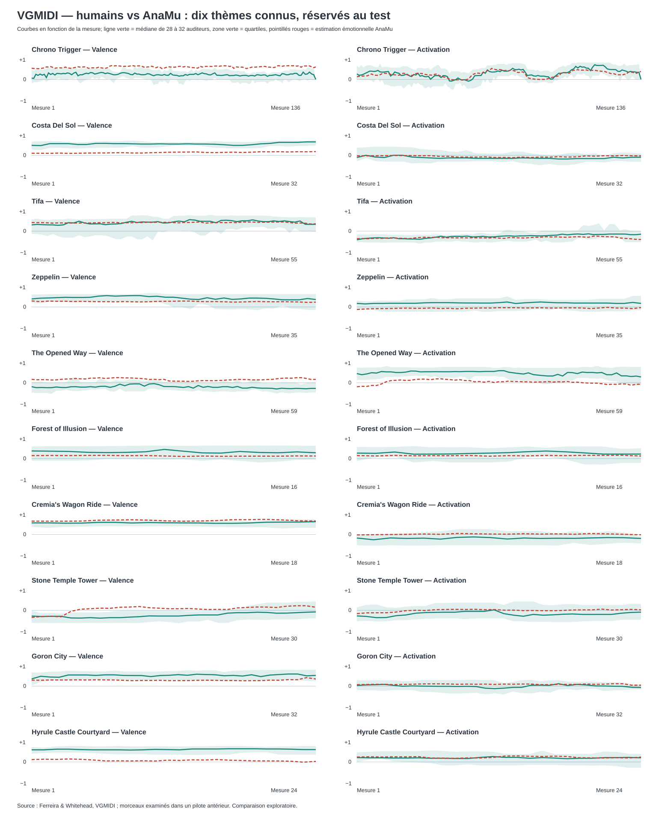

# VGMIDI — émotions humaines vs analyse AnaMu sur 10 thèmes connus

**Expérience exécutée**, pas un résultat simulé. AnaMu **estime les émotions
exprimées dans une musique déjà composée** à partir de ses MIDI originaux ;
il ne cherche pas à prévoir les notes ou les émotions futures.
Les humains ont évalué valence et activation
à chaque mesure. Les courbes complètes sont dans le JSON associé.
« Jamais vus » signifie exclusivement *absents de l'entraînement du modèle* :
il s'agit de thèmes connus de jeux vidéo, identifiés précisément dans le tableau ci-dessous.
**Attention :** ces dix thèmes ont déjà été inspectés dans le premier pilote ;
cette nouvelle comparaison est **exploratoire**, pas une validation indépendante intacte.

- Pièces téléchargées : **200**, éligibles : **141**, refusées : **59**.
- Partitions : **111** entraînement, **20** validation, **10** test (aucune pièce partagée).
- Modèle retenu sur la validation : **ridge_100**.
- Erreur moyenne absolue (MAE, sur échelle −1 à +1), test : **V = 0.263, A = 0.150** ; baseline constante : V = 0.289, A = 0.208.
- **Forme temporelle**, corrélation intra-pièce moyenne : **valence +0.20**, **activation +0.41** (mesure plus exigeante que la moyenne par chanson).
- Dans les **quartiles humains** à chaque mesure : **V 44.2%**, **A 89.5%** (moyenne équilibrée par pièce ; ce n'est pas un test de causalité).

## Sources réellement intégrées à cette exécution

- `original_partitura` : **3 colonnes** effectivement disponibles dans le schéma.
- `original_music21` : **10 colonnes** effectivement disponibles dans le schéma.
- `original_melody_features` : **684 colonnes** effectivement disponibles dans le schéma.
- `original_narmour` : **11 colonnes** effectivement disponibles dans le schéma.
- `original_jsymbolic` : **227 colonnes** effectivement disponibles dans le schéma.
- `local_theory_proxies` : **30 colonnes** effectivement disponibles dans le schéma.
- `train_only_expectancy` : **14 colonnes** effectivement disponibles dans le schéma.
- `temporal_memory_transforms` : **208 colonnes** effectivement disponibles dans le schéma.
- `original_midi_baselines` : **16 colonnes** effectivement disponibles dans le schéma.

### Couverture des 23 mécanismes recensés

| Mécanisme | Exécution réelle ou approximation | Pièces couvertes |
|---|---|---:|
| M1 — statistical_melodic_expectancy | theory_inspired_proxy_not_full_replication : train-only variable-order ngram, explicitly NOT original IDyOM | 141/141 |
| M2 — narmour_implication_realization | published_engine_executed : melody-features 1.3.3 / Narmour | 141/141 |
| M3 — statistical_harmonic_expectancy | theory_inspired_proxy_not_full_replication : train-only sonority ngram, unverified chord tokenization | 141/141 |
| M4 — chew_herremans_tonal_tension | published_engine_executed : Partitura / Herremans-Chew | 141/141 |
| M5 — krumhansl_schmuckler_key | published_engine_executed : music21 / Krumhansl-Schmuckler | 141/141 |
| M6 — roman_harmonic_functions | published_engine_executed : music21 / Roman-numeral hypotheses | 141/141 |
| M7 — tonal_pitch_space_proxy_not_lerdahl_original | theory_inspired_proxy_not_full_replication : tonic-chord and fifth-distance proxy, NOT Lerdahl TPS | 141/141 |
| M8 — cadential_resolution_hypotheses | theory_inspired_proxy_not_full_replication : tonic-restoration and dominant-to-tonic proxy | 141/141 |
| M9 — melodic_rhythmic_motifs | published_engine_executed : melody-features / melodic motifs | 141/141 |
| M10 — phrasing_segmentation_proxies | theory_inspired_proxy_not_full_replication : measure-boundary rests and motif grouping proxy | 141/141 |
| M11 — metric_accents | published_engine_executed : jSymbolic 2.2 + melody-features | 141/141 |
| M12 — metrical_syncopation_proxies | published_engine_executed : jSymbolic 2.2 + melody-features | 141/141 |
| M13 — jsymbolic_polyphony_texture | published_engine_executed : jSymbolic 2.2 original Java | 137/141 |
| M14 — articulation_dynamics | published_engine_executed : jSymbolic 2.2 original Java | 137/141 |
| M15 — symbolic_dissonance_not_acoustic_roughness | theory_inspired_proxy_not_full_replication : MIDI vertical interval clash, NOT acoustic roughness | 141/141 |
| M16 — voice_leading_hypotheses | theory_inspired_proxy_not_full_replication : independent track-direction proxy; voice identity unverified | 141/141 |
| M17 — temporal_tension_memory_inspired_by_farbood | theory_inspired_proxy_not_full_replication : multiscale feature memory, NOT fitted Farbood original | 141/141 |
| M18 — entropy_surprisal_interaction_inspired_by_cheung | theory_inspired_proxy_not_full_replication : entropy/surprisal interaction on training-only ngrams | 141/141 |
| M19 — itpra_framework_not_directly_observable | framework_only : Huron ITPRA: cognitive framework, not inferred mental states | 0/141 |
| M20 — style_memory_and_local_familiarity | theory_inspired_proxy_not_full_replication : within-piece motif repetition and training-only ngram | 141/141 |
| M21 — style_descriptors_from_existing_engines | published_engine_executed : jSymbolic 2.2 + melody-features descriptors | 141/141 |
| M22 — supervised_emotion_trajectory | evaluated_against_humans : supervised human-valence/arousal regression | 141/141 |
| M23 — human_annotator_variation_evaluation_only | human_labels_preserved_not_features : median and quartiles of real raters, evaluation side only | 141/141 |

- Pièces traitées par le Java original jSymbolic : **137**.
- Pièces traitées par `melody-features` original : **141**.
- Les colonnes globales ne donnent **aucune information temporelle locale** ; la comparaison mesure par mesure est possible grâce aux colonnes vraiment temporelles.
- IDyOM original n'est PAS remplacé par le modèle n-gramme de contrôle. Les mécanismes cognitifs non exécutables figurent explicitement comme manquants.

| Morceau connu (réservé au test) | Humains V | AnaMu V | Humains A | AnaMu A | MAE V / A |
|---|---:|---:|---:|---:|---:|
| Chrono Trigger (136 mesures) | +0.23 | +0.58 | +0.29 | +0.25 | 0.35 / 0.10 |
| Costa Del Sol (32 mesures) | +0.53 | +0.13 | -0.11 | -0.05 | 0.40 / 0.07 |
| Tifa (55 mesures) | +0.40 | +0.39 | -0.24 | -0.30 | 0.06 / 0.08 |
| Zeppelin (35 mesures) | +0.42 | +0.25 | +0.18 | -0.06 | 0.17 / 0.24 |
| The Opened Way (59 mesures) | -0.19 | +0.16 | +0.45 | +0.03 | 0.35 / 0.42 |
| Forest of Illusion (16 mesures) | +0.31 | +0.13 | +0.26 | +0.14 | 0.18 / 0.12 |
| Cremia's Wagon Ride (18 mesures) | +0.54 | +0.65 | -0.17 | +0.01 | 0.10 / 0.19 |
| Stone Temple Tower (30 mesures) | -0.23 | +0.05 | -0.17 | -0.01 | 0.29 / 0.16 |
| Goron City (32 mesures) | +0.49 | +0.28 | +0.00 | +0.08 | 0.22 / 0.08 |
| Hyrule Castle Courtyard (24 mesures) | +0.58 | +0.07 | +0.19 | +0.22 | 0.51 / 0.04 |

## Trajectoires temporelles (mêmes mesures, mêmes pièces)

Chaque nombre est V ou A sur [−1, +1]. Voir le JSON pour **toutes** les mesures,
les quartiles humains (désaccords individuels) et les sorties du modèle.

### Chrono Trigger

| Mesure | Humains V | AnaMu V | Humains A | AnaMu A | N humains |
|---:|---:|---:|---:|---:|---:|
| 1 | +0.07 | +0.52 | +0.26 | +0.13 | 30 |
| 35 | +0.32 | +0.52 | +0.15 | +0.21 | 30 |
| 69 | +0.20 | +0.57 | +0.36 | +0.45 | 30 |
| 103 | +0.19 | +0.50 | +0.45 | +0.39 | 30 |
| 136 | +0.00 | +0.58 | +0.00 | +0.36 | 30 |

### Costa Del Sol

| Mesure | Humains V | AnaMu V | Humains A | AnaMu A | N humains |
|---:|---:|---:|---:|---:|---:|
| 1 | +0.46 | +0.10 | -0.10 | -0.03 | 31 |
| 9 | +0.55 | +0.11 | -0.12 | -0.02 | 31 |
| 17 | +0.52 | +0.15 | -0.14 | -0.10 | 31 |
| 25 | +0.49 | +0.15 | -0.15 | -0.07 | 31 |
| 32 | +0.62 | +0.17 | -0.09 | -0.03 | 31 |

### Tifa

| Mesure | Humains V | AnaMu V | Humains A | AnaMu A | N humains |
|---:|---:|---:|---:|---:|---:|
| 1 | +0.29 | +0.40 | -0.40 | -0.35 | 30 |
| 14 | +0.34 | +0.39 | -0.33 | -0.28 | 30 |
| 28 | +0.43 | +0.39 | -0.24 | -0.32 | 30 |
| 42 | +0.48 | +0.42 | -0.15 | -0.27 | 30 |
| 55 | +0.32 | +0.33 | -0.14 | -0.39 | 30 |

### Zeppelin

| Mesure | Humains V | AnaMu V | Humains A | AnaMu A | N humains |
|---:|---:|---:|---:|---:|---:|
| 1 | +0.37 | +0.28 | +0.17 | -0.12 | 28 |
| 9 | +0.50 | +0.25 | +0.19 | -0.06 | 28 |
| 18 | +0.45 | +0.26 | +0.20 | -0.03 | 28 |
| 27 | +0.41 | +0.24 | +0.18 | -0.04 | 28 |
| 35 | +0.34 | +0.22 | +0.17 | -0.03 | 28 |

### The Opened Way

| Mesure | Humains V | AnaMu V | Humains A | AnaMu A | N humains |
|---:|---:|---:|---:|---:|---:|
| 1 | -0.18 | +0.16 | +0.43 | -0.18 | 30 |
| 15 | -0.17 | +0.23 | +0.51 | +0.17 | 30 |
| 30 | -0.17 | +0.08 | +0.56 | +0.05 | 30 |
| 45 | -0.24 | +0.15 | +0.47 | +0.02 | 30 |
| 59 | -0.26 | +0.16 | +0.27 | -0.06 | 30 |

### Forest of Illusion

| Mesure | Humains V | AnaMu V | Humains A | AnaMu A | N humains |
|---:|---:|---:|---:|---:|---:|
| 1 | +0.35 | +0.14 | +0.26 | +0.14 | 30 |
| 5 | +0.28 | +0.15 | +0.21 | +0.14 | 30 |
| 9 | +0.34 | +0.10 | +0.28 | +0.14 | 30 |
| 13 | +0.29 | +0.11 | +0.27 | +0.15 | 30 |
| 16 | +0.27 | +0.12 | +0.21 | +0.12 | 30 |

### Cremia's Wagon Ride

| Mesure | Humains V | AnaMu V | Humains A | AnaMu A | N humains |
|---:|---:|---:|---:|---:|---:|
| 1 | +0.54 | +0.62 | -0.16 | -0.02 | 30 |
| 5 | +0.56 | +0.66 | -0.17 | +0.02 | 30 |
| 10 | +0.54 | +0.61 | -0.21 | +0.01 | 30 |
| 14 | +0.53 | +0.68 | -0.18 | +0.01 | 30 |
| 18 | +0.59 | +0.62 | -0.18 | -0.02 | 30 |

### Stone Temple Tower

| Mesure | Humains V | AnaMu V | Humains A | AnaMu A | N humains |
|---:|---:|---:|---:|---:|---:|
| 1 | -0.27 | -0.33 | -0.26 | -0.15 | 30 |
| 8 | -0.36 | +0.10 | -0.11 | -0.01 | 30 |
| 16 | -0.27 | +0.07 | -0.16 | +0.01 | 30 |
| 23 | -0.11 | +0.13 | -0.17 | +0.01 | 30 |
| 30 | -0.07 | +0.14 | -0.09 | +0.02 | 30 |

### Goron City

| Mesure | Humains V | AnaMu V | Humains A | AnaMu A | N humains |
|---:|---:|---:|---:|---:|---:|
| 1 | +0.33 | +0.28 | +0.03 | +0.07 | 30 |
| 9 | +0.52 | +0.29 | -0.01 | +0.10 | 30 |
| 17 | +0.53 | +0.26 | -0.10 | +0.09 | 30 |
| 25 | +0.53 | +0.25 | +0.08 | +0.08 | 30 |
| 32 | +0.49 | +0.33 | -0.07 | +0.04 | 30 |

### Hyrule Castle Courtyard

| Mesure | Humains V | AnaMu V | Humains A | AnaMu A | N humains |
|---:|---:|---:|---:|---:|---:|
| 1 | +0.56 | +0.11 | +0.20 | +0.23 | 29 |
| 7 | +0.56 | +0.05 | +0.17 | +0.18 | 29 |
| 13 | +0.56 | +0.07 | +0.21 | +0.27 | 29 |
| 19 | +0.61 | +0.05 | +0.17 | +0.19 | 29 |
| 24 | +0.57 | +0.03 | +0.19 | +0.22 | 29 |

## Interprétation et limites

- **Les outils de théorie musicale ne produisent pas directement des émotions.** Ils produisent des caractéristiques musicales qui ont ensuite été reliées aux évaluations des humains par un modèle supervisé.
- Le test est **interne à VGMIDI** ; le corpus EMOPIA est réservé à une future validation externe.
- Les MIDI à mesure/tempo ambigu ont été refusés *avant* le choix des dix pièces.
- Le cas échéant, la baseline constante peut battre le moteur : on le signale, sans masquer les échecs.
- Les évaluations sont subjectives ; 30 personnes peuvent ne pas être d'accord, leurs quartiles sont conservés dans le JSON.
- Seules les sorties Java jSymbolic effectivement présentes dans la run sont comptées. Le Lisp IDyOM original n'a pas été exécuté.
- La corrélation des formes temporelles doit être examinée séparément : un bon score moyen ne signifie pas que tous les crescendos affectifs sont bien détectés.

**Source :** [VGMIDI, Ferreira & Whitehead](https://github.com/lucasnfe/vgmidi), révision `1e62f0a`. Articles originaux : *Learning to Generate Music with Sentiment* (ISMIR 2019), Herremans & Chew (Tension Ribbons), Krumhansl–Schmuckler.
