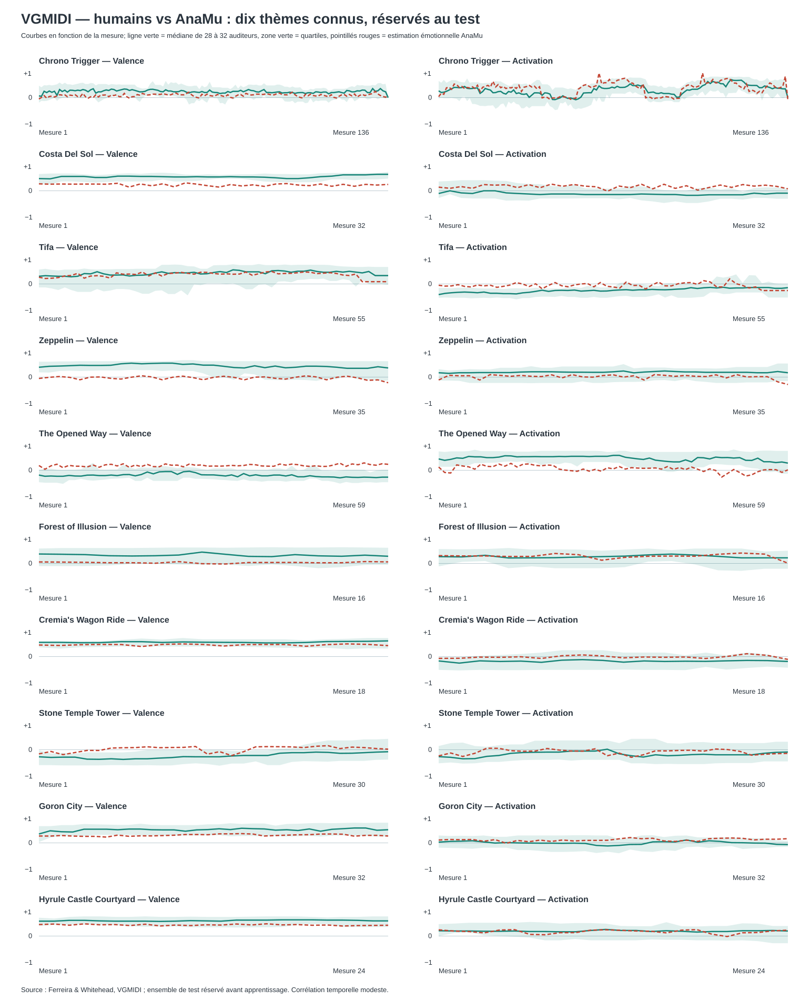

# VGMIDI — émotions humaines vs analyse AnaMu sur 10 thèmes connus

**Expérience exécutée**, pas un résultat simulé. AnaMu **estime les émotions
exprimées dans une musique déjà composée** à partir de ses MIDI originaux ;
il ne cherche pas à prévoir les notes ou les émotions futures.
Les humains ont évalué valence et activation
à chaque mesure. Les courbes complètes sont dans le JSON associé.
« Jamais vus » signifie exclusivement *absents de l'entraînement du modèle* :
il s'agit de thèmes connus de jeux vidéo, par exemple *Chrono Trigger* et *Goron City*.

- Pièces téléchargées : **200**, éligibles : **141**, refusées : **59**.
- Partitions : **111** entraînement, **20** validation, **10** test (aucune pièce partagée).
- Modèle retenu sur la validation : **ridge_10**.
- Erreur moyenne absolue (MAE, sur échelle −1 à +1), test : **V = 0.236, A = 0.172** ; baseline constante : V = 0.289, A = 0.208.
- **Forme temporelle**, corrélation intra-pièce moyenne : **valence +0.08**, **activation +0.23** (mesure plus exigeante que la moyenne par chanson).

| Morceau connu (réservé au test) | Humains V | AnaMu V | Humains A | AnaMu A | MAE V / A |
|---|---:|---:|---:|---:|---:|
| Chrono Trigger (136 mesures) | +0.23 | +0.09 | +0.29 | +0.35 | 0.14 / 0.15 |
| Costa Del Sol (32 mesures) | +0.53 | +0.23 | -0.11 | +0.16 | 0.30 / 0.27 |
| Tifa (55 mesures) | +0.40 | +0.34 | -0.24 | -0.06 | 0.09 / 0.20 |
| Zeppelin (35 mesures) | +0.42 | -0.03 | +0.18 | +0.02 | 0.45 / 0.17 |
| The Opened Way (59 mesures) | -0.19 | +0.18 | +0.45 | +0.06 | 0.37 / 0.40 |
| Forest of Illusion (16 mesures) | +0.31 | +0.03 | +0.26 | +0.27 | 0.28 / 0.09 |
| Cremia's Wagon Ride (18 mesures) | +0.54 | +0.44 | -0.17 | -0.01 | 0.10 / 0.16 |
| Stone Temple Tower (30 mesures) | -0.23 | +0.02 | -0.17 | -0.08 | 0.25 / 0.12 |
| Goron City (32 mesures) | +0.49 | +0.29 | +0.00 | +0.11 | 0.21 / 0.11 |
| Hyrule Castle Courtyard (24 mesures) | +0.58 | +0.42 | +0.19 | +0.16 | 0.16 / 0.05 |

## Trajectoires temporelles (mêmes mesures, mêmes pièces)

Chaque nombre est V ou A sur [−1, +1]. Voir le JSON pour **toutes** les mesures,
les quartiles humains (désaccords individuels) et les sorties du modèle.

### Chrono Trigger

| Mesure | Humains V | AnaMu V | Humains A | AnaMu A | N humains |
|---:|---:|---:|---:|---:|---:|
| 1 | +0.07 | -0.05 | +0.26 | +0.04 | 30 |
| 35 | +0.32 | +0.03 | +0.15 | +0.42 | 30 |
| 69 | +0.20 | +0.06 | +0.36 | +0.56 | 30 |
| 103 | +0.19 | -0.01 | +0.45 | +0.93 | 30 |
| 136 | +0.00 | +0.07 | +0.00 | -0.11 | 30 |

### Costa Del Sol

| Mesure | Humains V | AnaMu V | Humains A | AnaMu A | N humains |
|---:|---:|---:|---:|---:|---:|
| 1 | +0.46 | +0.26 | -0.10 | +0.14 | 31 |
| 9 | +0.55 | +0.14 | -0.12 | +0.23 | 31 |
| 17 | +0.52 | +0.14 | -0.14 | +0.18 | 31 |
| 25 | +0.49 | +0.19 | -0.15 | +0.12 | 31 |
| 32 | +0.62 | +0.24 | -0.09 | +0.07 | 31 |

### Tifa

| Mesure | Humains V | AnaMu V | Humains A | AnaMu A | N humains |
|---:|---:|---:|---:|---:|---:|
| 1 | +0.29 | +0.25 | -0.40 | -0.05 | 30 |
| 14 | +0.34 | +0.37 | -0.33 | -0.00 | 30 |
| 28 | +0.43 | +0.40 | -0.24 | -0.12 | 30 |
| 42 | +0.48 | +0.45 | -0.15 | +0.12 | 30 |
| 55 | +0.32 | +0.09 | -0.14 | -0.25 | 30 |

### Zeppelin

| Mesure | Humains V | AnaMu V | Humains A | AnaMu A | N humains |
|---:|---:|---:|---:|---:|---:|
| 1 | +0.37 | -0.05 | +0.17 | -0.11 | 28 |
| 9 | +0.50 | -0.07 | +0.19 | +0.06 | 28 |
| 18 | +0.45 | -0.01 | +0.20 | +0.09 | 28 |
| 27 | +0.41 | +0.05 | +0.18 | +0.02 | 28 |
| 35 | +0.34 | -0.21 | +0.17 | -0.28 | 28 |

### The Opened Way

| Mesure | Humains V | AnaMu V | Humains A | AnaMu A | N humains |
|---:|---:|---:|---:|---:|---:|
| 1 | -0.18 | +0.18 | +0.43 | +0.12 | 30 |
| 15 | -0.17 | +0.24 | +0.51 | +0.23 | 30 |
| 30 | -0.17 | +0.16 | +0.56 | +0.05 | 30 |
| 45 | -0.24 | +0.16 | +0.47 | -0.05 | 30 |
| 59 | -0.26 | +0.22 | +0.27 | +0.02 | 30 |

### Forest of Illusion

| Mesure | Humains V | AnaMu V | Humains A | AnaMu A | N humains |
|---:|---:|---:|---:|---:|---:|
| 1 | +0.35 | +0.06 | +0.26 | +0.29 | 30 |
| 5 | +0.28 | +0.03 | +0.21 | +0.26 | 30 |
| 9 | +0.34 | -0.02 | +0.28 | +0.23 | 30 |
| 13 | +0.29 | +0.02 | +0.27 | +0.34 | 30 |
| 16 | +0.27 | +0.06 | +0.21 | +0.01 | 30 |

### Cremia's Wagon Ride

| Mesure | Humains V | AnaMu V | Humains A | AnaMu A | N humains |
|---:|---:|---:|---:|---:|---:|
| 1 | +0.54 | +0.44 | -0.16 | -0.07 | 30 |
| 5 | +0.56 | +0.45 | -0.17 | -0.01 | 30 |
| 10 | +0.54 | +0.40 | -0.21 | -0.05 | 30 |
| 14 | +0.53 | +0.39 | -0.18 | -0.07 | 30 |
| 18 | +0.59 | +0.41 | -0.18 | -0.10 | 30 |

### Stone Temple Tower

| Mesure | Humains V | AnaMu V | Humains A | AnaMu A | N humains |
|---:|---:|---:|---:|---:|---:|
| 1 | -0.27 | -0.16 | -0.26 | -0.23 | 30 |
| 8 | -0.36 | +0.08 | -0.11 | -0.06 | 30 |
| 16 | -0.27 | -0.07 | -0.16 | -0.13 | 30 |
| 23 | -0.11 | +0.08 | -0.17 | -0.05 | 30 |
| 30 | -0.07 | +0.02 | -0.09 | -0.14 | 30 |

### Goron City

| Mesure | Humains V | AnaMu V | Humains A | AnaMu A | N humains |
|---:|---:|---:|---:|---:|---:|
| 1 | +0.33 | +0.26 | +0.03 | +0.11 | 30 |
| 9 | +0.52 | +0.25 | -0.01 | +0.04 | 30 |
| 17 | +0.53 | +0.34 | -0.10 | +0.15 | 30 |
| 25 | +0.53 | +0.31 | +0.08 | +0.16 | 30 |
| 32 | +0.49 | +0.26 | -0.07 | +0.16 | 30 |

### Hyrule Castle Courtyard

| Mesure | Humains V | AnaMu V | Humains A | AnaMu A | N humains |
|---:|---:|---:|---:|---:|---:|
| 1 | +0.56 | +0.43 | +0.20 | +0.23 | 29 |
| 7 | +0.56 | +0.40 | +0.17 | +0.06 | 29 |
| 13 | +0.56 | +0.41 | +0.21 | +0.22 | 29 |
| 19 | +0.61 | +0.41 | +0.17 | +0.07 | 29 |
| 24 | +0.57 | +0.41 | +0.19 | +0.22 | 29 |

## Interprétation et limites

- **Les scores ne sont pas des émotions créées directement par Partitura ou music21.** Les deux outils produisent des caractéristiques musicales qui ont ensuite été reliées aux évaluations des humains par un modèle supervisé.
- Le test est **interne à VGMIDI** ; le corpus EMOPIA est réservé à une future validation externe.
- Les MIDI à mesure/tempo ambigu ont été refusés *avant* le choix des dix pièces.
- Le cas échéant, la baseline constante peut battre le moteur : on le signale, sans masquer les échecs.
- Les évaluations sont subjectives ; 30 personnes peuvent ne pas être d'accord, leurs quartiles sont conservés dans le JSON.
- Les sorties Java jSymbolic et Lisp IDyOM ne figurent pas dans cette run ; leur intégration à cette expérience est un travail encore ouvert.
- La corrélation des formes temporelles doit être examinée séparément : un bon score moyen ne signifie pas que tous les crescendos affectifs sont bien détectés.

**Source :** [VGMIDI, Ferreira & Whitehead](https://github.com/lucasnfe/vgmidi), révision `1e62f0a`. Articles originaux : *Learning to Generate Music with Sentiment* (ISMIR 2019), Herremans & Chew (Tension Ribbons), Krumhansl–Schmuckler.
